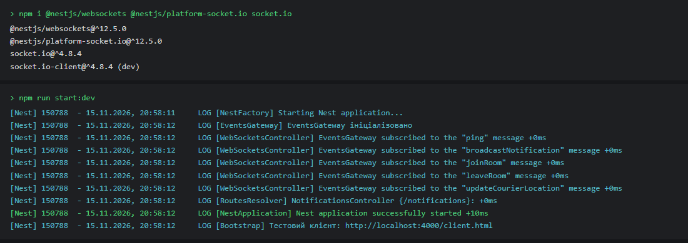
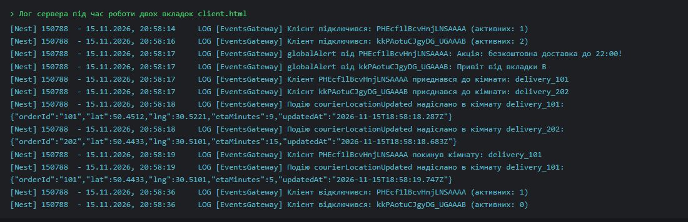
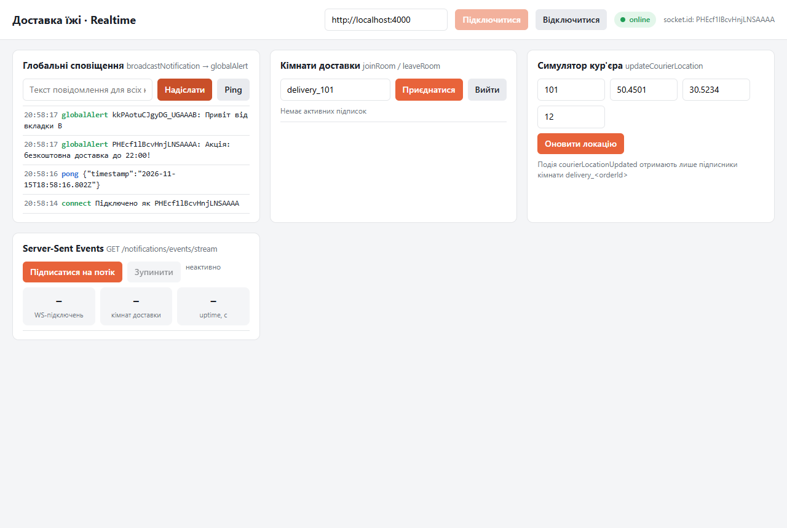
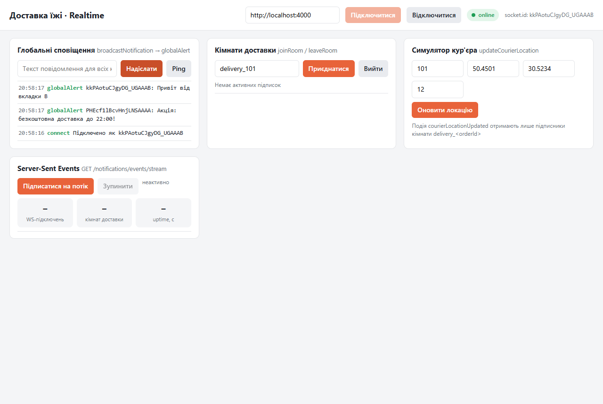
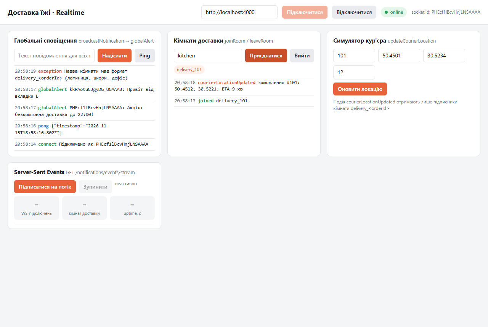
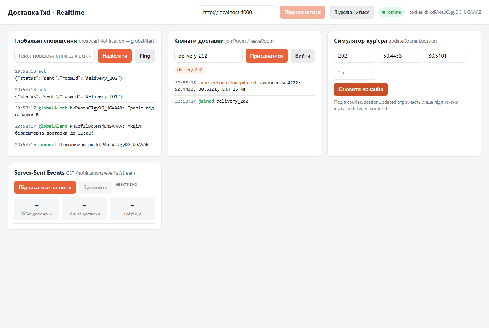
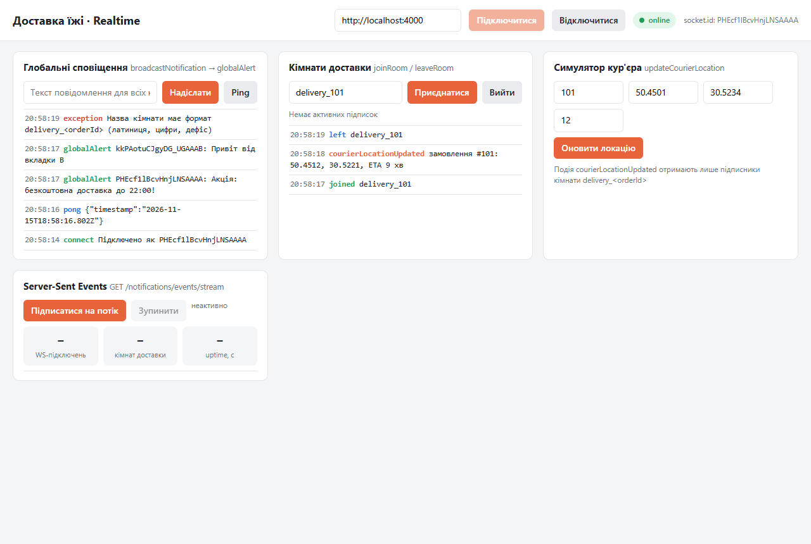
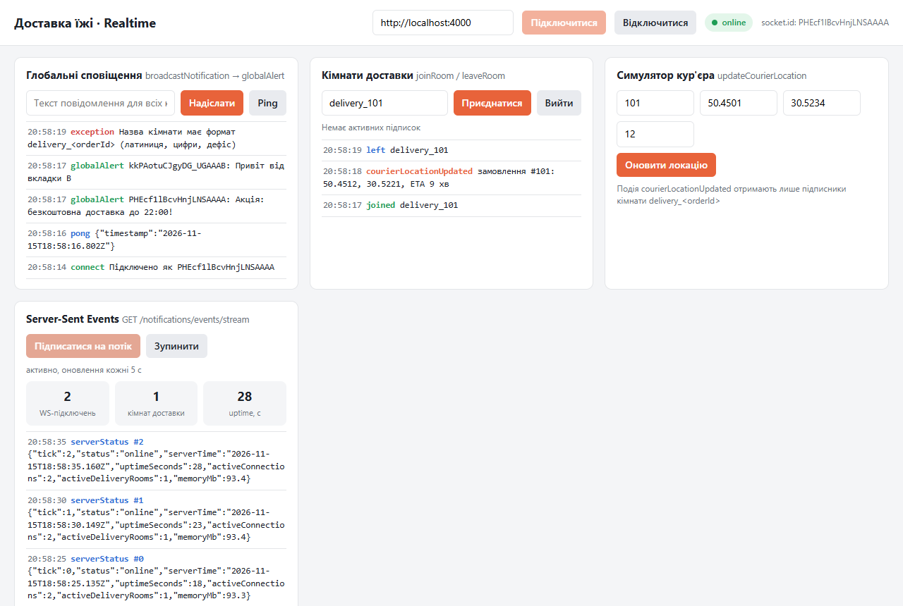
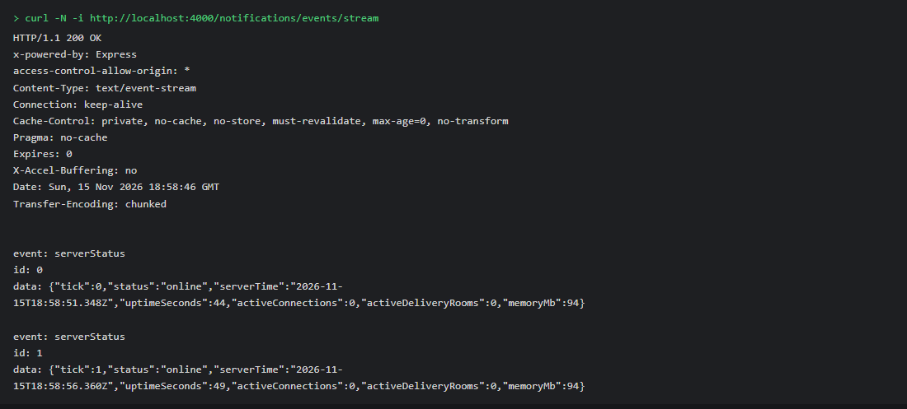
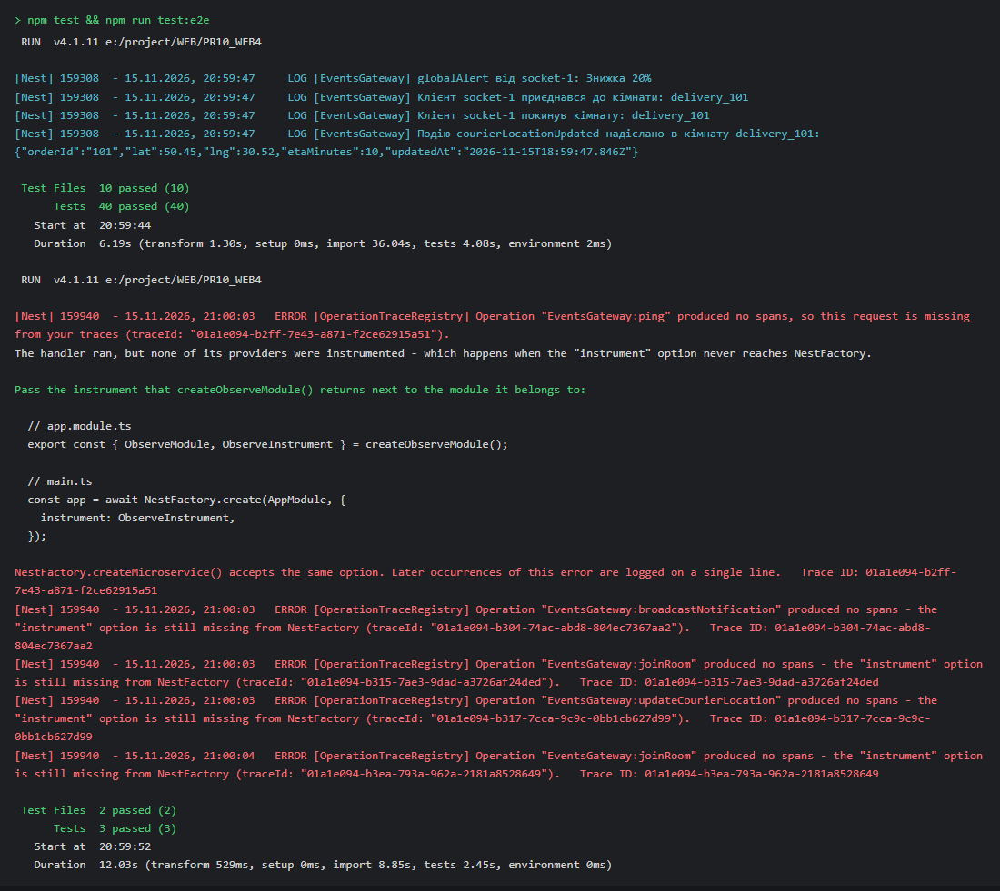

# Практична робота №10: комунікація в реальному часі

## Варіант 4: Ресторан та доставка їжі

| Кімната (Room) | WebSocket-подія | Email-нотифікація |
|---|---|---|
| `delivery_<orderId>` | `courierLocationUpdated` | етапи приготування та передача кур'єру (рівень 3, не виконувався) |

Проєкт продовжує ПР9. Додано модуль `NotificationsModule` з WebSocket-шлюзом на Socket.IO (`EventsGateway`), кімнатами доставки, SSE-потоком стану сервера та тестовою сторінкою `public/client.html`.

**Виконано:** рівень 1 і рівень 2. Рівень 3 (Mailpit, `nodemailer`, бізнес-сценарій із листом) не виконувався.

---

## 1. Стек

| Компонент | Версія |
|---|---|
| NestJS | 12 |
| @nestjs/websockets / @nestjs/platform-socket.io | 12.5 |
| socket.io / socket.io-client | 4.8 |
| RxJS | 7.8 |

```bash
npm i @nestjs/websockets @nestjs/platform-socket.io socket.io
npm i -D socket.io-client
```

`socket.io-client` потрібен лише для e2e-тестів. Сторінка `client.html` завантажує клієнтську бібліотеку з самого сервера (`/socket.io/socket.io.js`), тож версії клієнта й сервера завжди збігаються.

---

## 2. Рівень 1

### 2.1. `EventsGateway`

```ts
@Public()
@WebSocketGateway({ cors: { origin: '*' } })
export class EventsGateway
  implements OnGatewayInit, OnGatewayConnection, OnGatewayDisconnect
{
  private readonly logger = new Logger(EventsGateway.name);

  @WebSocketServer()
  server: Server;

  handleConnection(client: Socket): void {
    this.logger.log(`Клієнт підключився: ${client.id} (активних: ${this.connectionsCount})`);
  }

  handleDisconnect(client: Socket): void {
    this.logger.log(`Клієнт відключився: ${client.id} (активних: ${this.connectionsCount})`);
  }
}
```

> Глобальні `JwtAuthGuard` і `RolesGuard` з ПР9 зареєстровані через `APP_GUARD`, тому вони спрацьовують і для повідомлень WebSocket. Декоратор `@Public()` на класі шлюзу вимикає для нього JWT-перевірку. Так само позначено SSE-контролер.

### 2.2. `ping` і `broadcastNotification`

```ts
@SubscribeMessage('ping')
handlePing(@ConnectedSocket() client: Socket) {
  client.emit('pong', { timestamp: new Date().toISOString() });
}

@SubscribeMessage('broadcastNotification')
handleBroadcast(@MessageBody() message: unknown, @ConnectedSocket() client: Socket) {
  const text = typeof message === 'string' ? message.trim() : '';
  if (!text || text.length > 500) {
    throw new WsException('Повідомлення має бути непорожнім рядком до 500 символів');
  }
  this.server.emit('globalAlert', {
    sender: client.id,
    message: text,
    timestamp: new Date().toISOString(),
  });
}
```

`WsException` Nest передає клієнту як подію `exception`, і сторінка показує її червоним рядком.

### 2.3. Клієнт `public/client.html`

Сторінку роздає сам сервер: `app.useStaticAssets(join(process.cwd(), 'public'))` у `main.ts`. Адреса: **http://localhost:4000/client.html**. Її також можна відкрити як файл: адреса сервера задається в полі вгорі, а CORS дозволено.

На сторінці є:
- кнопки «Підключитися» / «Відключитися», статус і `socket.id`;
- поле тексту, кнопки «Надіслати» (`broadcastNotification`) і «Ping»; список `<ul>` подій `pong` / `globalAlert` / `exception`;
- блок кімнат: поле назви, «Приєднатися» / «Вийти», активні підписки та список подій кімнати;
- симулятор кур'єра: `orderId`, координати, ETA;
- блок SSE: підписка або зупинка, лічильники та список отриманих подій.

Усі дані з сервера вставляються в DOM через `textContent`, а не `innerHTML`. Тому текст повідомлення не може впровадити розмітку чи скрипт в інших вкладках.

---

## 3. Рівень 2

### 3.1. Кімнати `delivery_<orderId>`

```ts
export const DELIVERY_ROOM_PATTERN = /^delivery_[A-Za-z0-9-]{1,64}$/;

@SubscribeMessage('joinRoom')
async handleJoinRoom(@MessageBody('roomId') roomId: unknown, @ConnectedSocket() client: Socket) {
  const room = this.validateRoom(roomId);
  await client.join(room);
  client.emit('joined', { status: 'success', roomId: room });
}

@SubscribeMessage('leaveRoom')
async handleLeaveRoom(@MessageBody('roomId') roomId: unknown, @ConnectedSocket() client: Socket) {
  const room = this.validateRoom(roomId);
  await client.leave(room);
  client.emit('left', { status: 'success', roomId: room });
}

emitToRoom(roomId: string, event: string, data: unknown): void {
  this.server.to(roomId).emit(event, data);
}
```

Назва кімнати перевіряється за шаблоном. Тому клієнт не може приєднатися до довільної кімнати, зокрема до персональної кімнати іншого сокета, назва якої збігається з його `socket.id`.

Джерело подій для кімнати — повідомлення `updateCourierLocation` від кур'єра. Шлюз перевіряє координати й викликає `emitToRoom`:

```ts
@SubscribeMessage('updateCourierLocation')
handleCourierLocation(@MessageBody() body: CourierLocation) {
  const room = this.validateRoom(deliveryRoom(String(body?.orderId ?? '')));
  this.emitToRoom(room, 'courierLocationUpdated', { orderId, lat, lng, etaMinutes, updatedAt });
  return { status: 'sent', roomId: room };
}
```

Значення, яке повертає обробник, Socket.IO надсилає відправнику як acknowledgement. На сторінці це рядок `ack`.

### 3.2. Server-Sent Events

```ts
@Public()
@Controller('notifications')
export class NotificationsController {
  constructor(private readonly eventsGateway: EventsGateway) {}

  @Sse('events/stream')
  stream(): Observable<MessageEvent> {
    return interval(SSE_INTERVAL_MS).pipe(
      map((tick) => ({
        id: String(tick),
        type: 'serverStatus',
        data: {
          tick,
          status: 'online',
          serverTime: new Date().toISOString(),
          uptimeSeconds: Math.round(process.uptime()),
          activeConnections: this.eventsGateway.connectionsCount,
          activeDeliveryRooms: this.eventsGateway.deliveryRoomsCount,
          memoryMb: Math.round((process.memoryUsage().rss / 1024 / 1024) * 10) / 10,
        },
      })),
    );
  }
}
```

`SSE_INTERVAL_MS = 5000`. Кожне повідомлення має поля `event: serverStatus`, `id` і `data` (JSON). Клієнт підписується через `EventSource` і `addEventListener('serverStatus', ...)`. Коли браузер закриває з'єднання, Nest відписується від `Observable`, тож таймер `interval` не продовжує працювати.

### 3.3. Виправлення `TrimPipe`

Глобальні пайпи з `useGlobalPipes` застосовуються й до обробників WebSocket. Старий `TrimPipe` рекурсивно обходив будь-який об'єкт, тому на аргументі `@ConnectedSocket()` (об'єкт `Socket` має циклічні посилання) падав з `Maximum call stack size exceeded`. Тепер пайп обробляє лише аргументи типу `body`/`query`/`param` і лише «звичайні» об'єкти та масиви.

---

## 4. Структура (нове та змінене)

```
PR10_WEB4/
├── public/client.html                       # тестовий клієнт
├── src/
│   ├── main.ts                              # useStaticAssets, enableCors
│   ├── common/pipes/trim.pipe.ts            # безпечний для WebSocket
│   └── notifications/
│       ├── events.gateway.ts                # Socket.IO-шлюз, кімнати
│       ├── events.gateway.spec.ts
│       ├── notifications.controller.ts      # @Sse('events/stream')
│       ├── notifications.controller.spec.ts
│       └── notifications.module.ts
└── test/realtime.e2e-spec.ts                # socket.io-client проти реального сервера
```

---

## 5. Інструкція із запуску

```bash
npm install
cp .env.example .env
docker compose up -d
npm run migration:run
npm run start:dev
```

1. Відкрийте http://localhost:4000/client.html у двох вкладках і натисніть «Підключитися» в обох.
2. Надішліть повідомлення з однієї вкладки: обидві отримають `globalAlert`.
3. У вкладці A приєднайтеся до `delivery_101`, у вкладці B — до `delivery_202`.
4. У симуляторі кур'єра надішліть локацію для `101`, потім для `202`. Кожна вкладка побачить лише своє замовлення.
5. Натисніть «Підписатися на потік»: щоп'ять секунд надходить `serverStatus`.

Сирий SSE-потік: `curl -N http://localhost:4000/notifications/events/stream`.

Тести:

```bash
npm test
npm run test:e2e
```

---

## 6. Скриншоти

### 6.1. Залежності та запуск: шлюз підписався на всі повідомлення


### 6.2. Лог сервера: підключення, broadcast, кімнати, відключення


### 6.3. Вкладка A: `pong` і `globalAlert` від обох вкладок


### 6.4. Вкладка B отримала ті самі глобальні повідомлення


### 6.5. Вкладка A в кімнаті `delivery_101`: отримала оновлення лише для замовлення #101; спроба увійти в `kitchen` відхилена


### 6.6. Вкладка B у кімнаті `delivery_202`: отримала оновлення лише для #202 і `ack` для обох відправок


### 6.7. Після `leaveRoom` вкладка A більше не отримує оновлень (третя відправка з ETA 5 хв до неї не дійшла)


### 6.8. SSE у браузері: події кожні 5 секунд, 2 WS-підключення, 1 кімната доставки


### 6.9. Формат `text/event-stream` (`event`, `id`, `data`)


### 6.10. Тести без помилок: unit 40/40, e2e 3/3


---

## 7. Висновки

Socket.IO-шлюз підтримує постійне двостороннє з'єднання. `server.emit` розсилає подію всім клієнтам, а `server.to(room).emit` — лише сокетам у кімнаті конкретного замовлення `delivery_<orderId>`. Кімнати керуються на сервері (`join`/`leave`) і мають перевірену назву, тому клієнт не підпишеться на чужі події. Для односторонніх періодичних оновлень використано SSE: RxJS `interval` + `map` формують `Observable<MessageEvent>`, який Nest віддає як `text/event-stream`, а браузер читає через `EventSource` з автоматичним перепідключенням.
